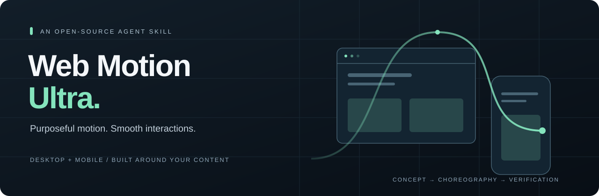

<p align="center">
  
</p>

<h1 align="center">Web Motion Ultra</h1>

<p align="center"><strong>Give every movement a purpose. Make every interaction feel connected.</strong></p>

<p align="center">
  <a href="LICENSE"></a>
  <a href="skills/web-motion-ultra/SKILL.md"></a>
  <a href="https://github.com/EchoteDev/web-motion-ultra/releases"></a>
  <a href="https://github.com/EchoteDev/web-motion-ultra/actions/workflows/validate.yml"></a>
</p>

An open-source AI coding skill for designing and implementing **smooth, purposeful web animations on desktop and mobile**. Turn a static landing page, portfolio, or product site into a choreographed experience with a clear motion concept, a signature moment, responsive interactions, and practical verification.

**Ultra means precision:** thoughtful timing, interruptible transitions, touch-aware behavior, and measured performance. The skill chooses effects to fit your content and brand.

[Quick start](#quick-start) · [Features](#features) · [How it works](#how-it-works) · [Example prompts](#example-prompts) · [Installation guide](docs/installation.md) · [Contributing](CONTRIBUTING.md)

## Quick start

### Install through Codex

Paste this into Codex:

```text
$skill-installer install the skill from
https://github.com/EchoteDev/web-motion-ultra/tree/main/skills/web-motion-ultra
```

Codex's built-in installer can download skills from other repositories. If the skill does not appear after installation, restart Codex. See the [official skill documentation](https://learn.chatgpt.com/docs/build-skills).

### Try it on your project

Open the website project in your coding agent and ask:

```text
Use $web-motion-ultra to bring this page to life.
Style: editorial and elegant. Intensity: medium.
Preserve the existing content, structure, and functionality.
Create a signature moment and supporting microinteractions.
Adapt the choreography for desktop and touch/mobile.
Implement the changes and verify the result where tools are available.
```

Provide the project files or page URL, the sections to work on, and any brand or stack constraints. For an existing site, the default is to enhance its motion while preserving its content and structure.

### Prefer a manual install?

```bash
git clone https://github.com/EchoteDev/web-motion-ultra.git
mkdir -p "$HOME/.agents/skills"
cp -R web-motion-ultra/skills/web-motion-ultra "$HOME/.agents/skills/"
```

Use this copy command for a **first installation** when the destination does not already exist. The [installation guide](docs/installation.md) covers project-only installation, Windows, ZIP downloads, updates, and removal.

## Features

| Capability | What the skill guides your agent to do |
| --- | --- |
| Motion direction | Define a concept and one signature moment tied to the page's purpose |
| Choreography | Coordinate entrances, overlap, pauses, stagger, and stable resting states |
| Responsive motion | Create desktop and touch profiles with a shared visual intention |
| Interruptible interactions | Handle rapid clicks, reversals, cancellation, and stale callbacks |
| Scroll storytelling | Use reveals, progress, pinning, and parallax only when justified |
| Microinteractions | Refine buttons, cards, menus, tabs, accordions, and form feedback |
| Progressive enhancement | Keep essential content usable when JavaScript or dependencies fail |
| Accessibility | Respect reduced motion, focus, keyboard navigation, semantics, and pause controls |
| Performance diagnosis | Identify expensive layout/paint, concurrent effects, and unnecessary loops |
| Verification | Check states, resize, navigation, remounts, touch behavior, and representative performance |

### Desktop and mobile are designed together

| Desktop behavior | Touch/mobile interpretation |
| --- | --- |
| Pointer-driven card accent | Immediate pressed-state feedback and a stable hit area |
| Spacious heading reveal | Shorter travel and stagger with the same hierarchy |
| Narrative pinned section | Usually a readable vertical sequence |
| Draggable gallery | Native scrolling where appropriate, plus alternative controls |
| Atmospheric visual effect | A simpler effect or static treatment when rendering cost is excessive |

Reduced motion gets its own complete presentation, with content in a valid, readable state. Mobile is not simply a smaller copy of the desktop animation.

## How it works

```text
Inspect the page
      ↓
Motion concept + signature moment
      ↓
Motion map + shared timing tokens
      ↓
Implementation in the existing stack
      ↓
Browser checks + refinement + tuning notes
```

1. **Understand:** inspect the content, primary action, existing motion, stack, and constraints.
2. **Direct:** define the movement concept and choose supporting effects with a clear purpose.
3. **Map:** specify triggers, properties, timing or scroll ranges, desktop/touch behavior, reduced-motion alternatives, and interruption handling.
4. **Implement:** edit project files using the existing architecture and only the dependencies the work needs.
5. **Verify:** exercise interactions and final states, correct observed problems, and report actual checks and remaining limitations.

These phases do not add approval stops unless you explicitly request checkpoints. You can also ask for a concept or audit without implementation.

### Example motion map

This is an illustrative plan, not a recorded benchmark or completed site demo.

| Element | Purpose | Trigger | Treatment | Touch/mobile | Reduced motion |
| --- | --- | --- | --- | --- | --- |
| Hero heading | Establish reading order | Initial render | Restrained line-mask reveal | Less travel, shorter stagger | Final readable state |
| Featured image | Create the signature moment | Viewport entry | Single masked reveal | Simplified mask or fade | Complete image |
| Project cards | Confirm interactivity | Hover/focus/press | Local visual lift | Pressed feedback | Immediate state change |
| Service accordion | Clarify disclosure | User activation | Interruptible panel transition | Same semantics and stable controls | Immediate disclosure |

## Example prompts

### Enhance an existing site

```text
Use $web-motion-ultra on this existing website.
Keep its content and information architecture.
Give each section a purposeful role in the choreography.
Use a calm, premium character and restrained intensity.
Prioritize mobile reading and immediate CTA availability.
```

### Create a new animated page

```text
Use $web-motion-ultra to create a product landing page.
Audience: independent designers. Goal: start a free trial.
Motion character: technical and precise. Intensity: medium.
Use the project's React stack and existing animation dependencies.
Design the layout and motion together, then implement and verify.
```

### Fix motion that feels rough

```text
Use $web-motion-ultra to inspect the current animations.
Focus on mobile scroll stutter, repeated menu taps, and resize jumps.
Record a baseline where measurement tools are available.
Fix the causes, preserve the visual intent, and report what was tested.
```

More briefs, checkpoint usage, and expected outputs are in [the prompt cookbook](docs/prompt-cookbook.md).

## Stack and agent compatibility

The skill is **instruction-based Markdown**, with Codex UI metadata. It ships no browser runtime, animation engine, npm package, paid service, or API key requirement. Your coding agent needs access to the website project to implement changes; browser tools are needed to exercise and measure the result.

| Stack/tool | Approach |
| --- | --- |
| HTML, CSS, vanilla JavaScript | CSS and native browser APIs for simple effects |
| GSAP + ScrollTrigger | Optional for complex choreography, pinning, and scrubbing |
| React with Motion/Framer Motion | Reuse when already adopted or requested |
| Lenis | Optional smooth-scroll integration when justified |
| Other web frameworks | Follow the project's components and lifecycle; verify library-specific APIs |
| Codex | Includes explicit `$web-motion-ultra` invocation and UI metadata |
| Other coding agents | Portable instructions; installation and invocation depend on the agent |

This repository does not claim automated compatibility testing across every agent or framework. No specific animation library is installed merely by adding the skill.

## What's inside

```text
skills/web-motion-ultra/
├── SKILL.md                         # Entry point and complete workflow
├── agents/openai.yaml               # Codex display name and default prompt
└── references/
    ├── effect-selection.md          # Purposeful effect selection and concepts
    ├── implementation-and-qa.md     # Initialization, lifecycle, accessibility, QA
    └── smooth-responsive-motion.md  # Choreography, input, interruptions, performance
```

Repository documentation stays outside the installable skill folder so agents load only relevant guidance. [Browse the skill](skills/web-motion-ultra/SKILL.md) before installing.

## FAQ

**Does this guarantee 60 or 120 fps?** No. The skill guides profiling and refinement. Results depend on implementation, content, browser, and hardware. Code review and screenshots cannot certify fluidity.

**Will it animate everything?** It selects a signature moment and supporting effects. Reading, primary actions, and interaction feedback take priority.

**Can I use it on an existing site?** Yes. Enhancement preserves content, structure, and functionality by default. Ask separately if you want a redesign.

**Does it support reduced motion?** The instructions require a complete reduced-motion presentation, runtime preference handling, and relevant verification. They do not certify a site's accessibility without testing.

**Is it free?** The repository is MIT-licensed. Any coding-agent subscription or third-party service you choose has its own terms and costs.

**Where are the demos?** This initial release contains the skill and documentation. The example motion map is illustrative. Real browser demos and community before/after recordings are welcome with clear provenance and test context.

## Contributing

Try it on a real project, report a reproducible failure, or submit a focused improvement. Include browser/device details and distinguish measured outcomes from visual impressions. See [CONTRIBUTING.md](CONTRIBUTING.md), [open an issue](https://github.com/EchoteDev/web-motion-ultra/issues/new/choose), or [suggest an improvement](https://github.com/EchoteDev/web-motion-ultra/issues/new?template=feature_request.md).

## Credits and license

Created and maintained by [EchoteDev](https://github.com/EchoteDev). The skill grew from a motion-design brief and iterative refinement with an AI coding agent.

Web Motion Ultra is an independent project, with its own instructions and scope; no affiliation or endorsement is implied.

MIT © 2026 EchoteDev. See [LICENSE](LICENSE). Third-party documentation and tools retain their respective licenses and terms.
